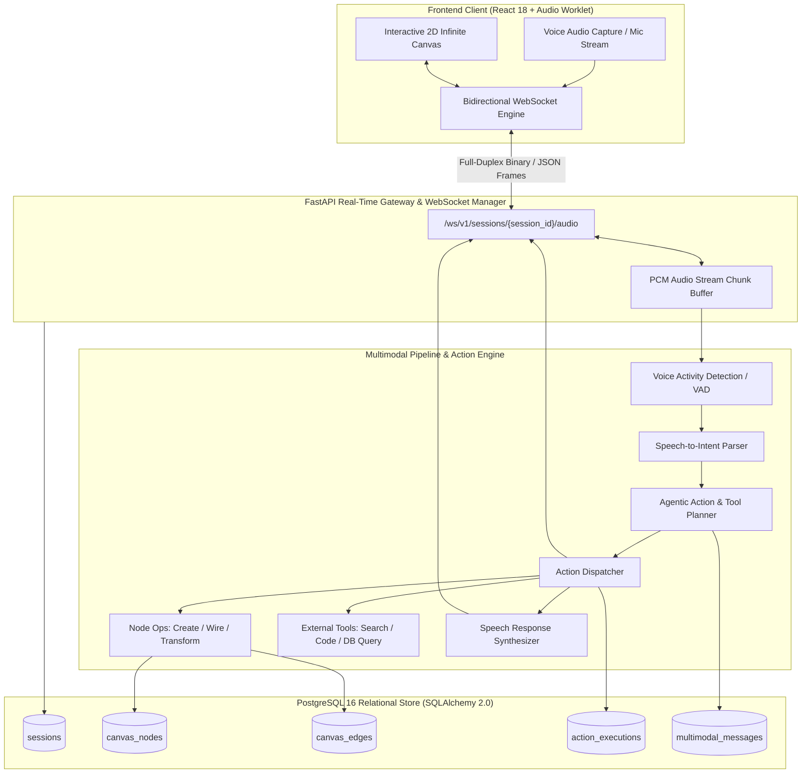

# 🎙️ NeuralCanvas — Multimodal Voice & Real-Time Action Cockpit

[](https://fastapi.tiangolo.com)
[](https://developer.mozilla.org/en-US/docs/Web/API/WebSockets_API)
[](https://www.postgresql.org)
[](https://www.sqlalchemy.org)
[](https://python.org)
[](https://opensource.org/licenses/MIT)

> **NeuralCanvas** is an enterprise-grade multimodal AI canvas and real-time voice-to-action workstation. It bridges low-latency streaming voice audio, speech-to-action semantic parsing, live visual canvas state machines, and structured tool execution DAGs over bidirectional WebSockets, persisting full session lineage, multimodal chat history, and canvas snapshots in PostgreSQL.

---

## 🏗️ Multimodal Real-Time Architecture



---

## 🌟 4-Day Sprint Roadmap

- [x] **Day 1: Scaffolding & Architecture**: PostgreSQL 16 schema design, SQLAlchemy 2.0 declarative models (`CanvasSession`, `CanvasNode`, `CanvasEdge`, `MultimodalMessage`, `ActionExecution`), Pydantic v2 schemas, application settings, database session pooling, and FastAPI lifecycle.
- [x] **Day 2: Core Logic & Real-Time WebSocket Engine**: Bidirectional WebSocket connection manager, streaming audio frame processor, VAD/intent classifier, action dispatcher engine, and RESTful session management APIs.
- [x] **Day 3: Frontend UI / Canvas Cockpit**: Interactive React 18 infinite canvas viewer, real-time audio visualizer waveform, live node manipulation, and WebSocket communication hook.
- [ ] **Day 4: Testing, Performance Benchmarks & Docker Compose**: Automated integration test suites, end-to-end WebSocket roundtrip latency benchmarks, demo data seeder, and containerized Docker Compose deployment.

---

## 🔌 API Endpoints Reference

| Method | Endpoint | Description |
| :--- | :--- | :--- |
| `POST` | `/api/v1/sessions` | Create a new interactive canvas workspace session |
| `GET` | `/api/v1/sessions` | List active sessions with pagination & timestamp sorting |
| `GET` | `/api/v1/sessions/{session_id}` | Retrieve full canvas session details, nodes, edges, messages, actions |
| `PATCH` | `/api/v1/sessions/{session_id}` | Update session title, description, viewport state, or status |
| `DELETE` | `/api/v1/sessions/{session_id}` | Delete session and cascade deletion to all graph elements |
| `GET` | `/api/v1/sessions/{session_id}/topology` | Graph topology analysis: in/out degrees, root/leaf nodes, cycle check |
| `POST` | `/api/v1/sessions/{session_id}/nodes` | Spawn a new node onto the 2D canvas |
| `GET` | `/api/v1/sessions/{session_id}/nodes` | List all nodes deployed in the session |
| `GET` | `/api/v1/sessions/{session_id}/nodes/{node_id}` | Retrieve single node state, coordinates, and execution data |
| `PATCH` | `/api/v1/sessions/{session_id}/nodes/{node_id}` | Update node coordinates, dimensions, label, or execution status |
| `DELETE` | `/api/v1/sessions/{session_id}/nodes/{node_id}` | Delete node and automatically detach attached edges |
| `POST` | `/api/v1/sessions/{session_id}/edges` | Wire two node handles together via directed connection |
| `GET` | `/api/v1/sessions/{session_id}/edges` | List all directed connections in the session |
| `DELETE` | `/api/v1/sessions/{session_id}/edges/{edge_id}` | Remove a directed edge connection |
| `POST` | `/api/v1/sessions/{session_id}/actions/voice-intent` | Dispatch speech-to-action intent, mutate canvas, broadcast to clients |
| `GET` | `/api/v1/sessions/{session_id}/actions` | Audit log of dispatched actions and execution latencies |
| `POST` | `/api/v1/sessions/{session_id}/actions/vad-check` | Analyze 16-bit PCM chunk for RMS energy and voice activity |
| `WS` | `/ws/v1/sessions/{session_id}` | Full-duplex WebSocket gateway for streaming speech and live state diffs |

---

## 🗄️ Database Architecture & Relational Schema

NeuralCanvas utilizes PostgreSQL with relational foreign keys, indexes, and JSONB payloads for dynamic attributes:

| Table | Primary Key | Description | Key Relationships |
| :--- | :--- | :--- | :--- |
| `canvas_sessions` | `session_id` | Top-level interactive canvas session and state metadata | One-to-Many with Nodes, Edges, Actions, Messages |
| `canvas_nodes` | `node_id` | Visual elements on the 2D plane (cards, prompts, charts, tools) | Belongs to `canvas_sessions` |
| `canvas_edges` | `edge_id` | Directed connections and dependency flow between nodes | Connects `source_node_id` and `target_node_id` |
| `multimodal_messages` | `message_id` | Chronological voice transcriptions and assistant responses | Belongs to `canvas_sessions` |
| `action_executions` | `action_id` | Audit trail of dispatched actions, tool calls, and state diffs | Belongs to `canvas_sessions` |

---

## ⚡ Real-Time WebSocket Protocol

The WebSocket connection handles multiplexed JSON control messages and binary audio packets:

```json
// Voice Audio Intent Packet (Client -> Server)
{
  "type": "voice_intent",
  "session_id": "sess_89f02c",
  "transcription": "Create a data transform node that filters customer churn > 0.8 and wire it to the Slack alert node",
  "confidence": 0.96,
  "timestamp": 1730543151
}

// Dispatched Action Frame (Server -> Client)
{
  "type": "action_dispatched",
  "session_id": "sess_89f02c",
  "action": {
    "action_id": "act_348ab1",
    "action_type": "CREATE_AND_CONNECT_NODE",
    "status": "success",
    "node": {
      "node_id": "node_churn_filter",
      "node_type": "filter",
      "position": {"x": 420, "y": 260},
      "properties": {"threshold": 0.8, "target_field": "churn_probability"}
    },
    "edge": {
      "edge_id": "edge_churn_to_slack",
      "source": "node_churn_filter",
      "target": "node_slack_alert"
    }
  }
}
```

---

## 🚀 Quickstart & Development

### 1. Requirements
- Python 3.11+
- PostgreSQL 14+ (or SQLite for local development)

### 2. Backend Setup
```bash
cd backend
python -m venv venv
source venv/bin/activate
pip install -r requirements.txt
```

### 3. Run FastAPI Development Server
```bash
uvicorn app.main:app --reload --port 8000
```
- Interactive API Docs: `http://localhost:8000/docs`
- Health Endpoint: `http://localhost:8000/health`

### 4. Frontend UI Setup
```bash
cd frontend
npm install
npm run dev
```
- Access the Cockpit at `http://localhost:5173`
